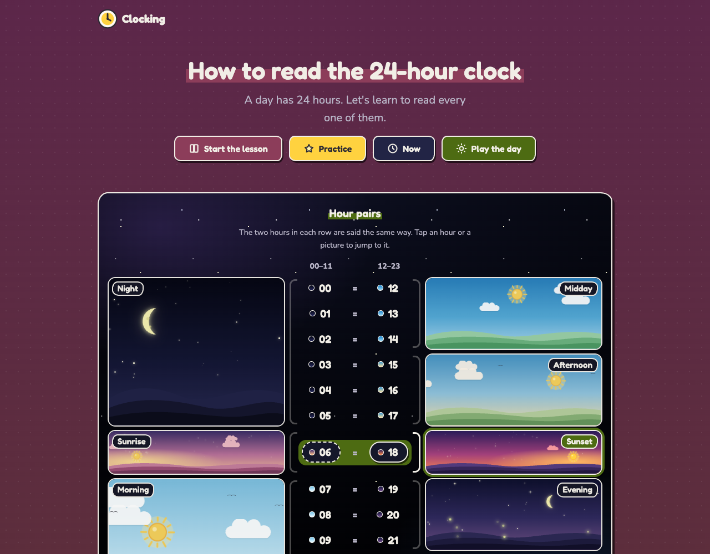

# Clocking: learn the 24-hour clock

A friendly, interactive website that teaches how to read the 24-hour clock.

**Live site: https://taldo17k.github.io/clocking/** · **בעברית: https://taldo17k.github.io/clocking/he/** · **中文: https://taldo17k.github.io/clocking/zh/**



## What's inside

- **Hour pairs:** the table from the original drawing. Each hour from 0–11 sits next to its partner 12 hours later (8 = 20), with an animated sky for every part of the day.
- **Dial clock:** a regular clock face, 1–12 with 12 at the top. Move the hands, then pick the time of day with the sun/moon switch (8 in the morning or 20 in the evening).
- **Digital clock:** change the time with the arrows, by swiping or with the keyboard, and read it as a sentence ("It's ten thirty-nine at night").
- **Lesson:** eight short steps: the day, hour pairs, how to read each clock, the two examples from the drawing (8:15 and 22:39), and Roni and Mika showing how to set each clock.
- **Practice quiz:** ten questions per round, with sounds, streaks and a best score.
- Everything stays in sync: change the time anywhere and the sky, table and clocks follow.

## Run it locally

You need [Node.js](https://nodejs.org/) 20 or newer. There is nothing to install.

```sh
npm run serve        # preview at http://localhost:8000 (Hebrew: /he/, Chinese: /zh/)
npm test             # unit tests for the clock, quiz and translated pages
npm run build:pages  # rebuild site/he/ and site/zh/ after editing site/index.html or site/strings/
```

Use `npm run serve` rather than `python3 -m http.server`. The Python server doesn't tell browsers to check for new files, so after an edit a browser can mix old and new JavaScript and break the page.

## How it's built

Plain HTML, CSS and JavaScript modules with no build step. The `site/` folder is the whole website.

| Path | What it holds |
|---|---|
| `site/js/time.js` | The clock rules (pairs, parts of the day, how a time is said), used everywhere |
| `site/js/quiz-core.js` | Quiz questions, answer checking and explanations |
| `site/strings/en.js`, `he.js`, `zh.js` | All the text on the site, in English, Hebrew and Chinese |
| `site/he/index.html`, `site/zh/index.html` | The translated pages, generated from `site/index.html` by `scripts/build-pages.mjs` |
| `site/js/scene.js`, `site/css/scene.css` | The animated sky scenes |
| `tests/` | Unit tests (`node --test`) |
| `documents/CONTENT.md` | The original drawing transcribed and translated, plus the content decisions |
| `PLAN.md` | The build plan, with success criteria for each step |

Every push to `main` runs the tests and deploys `site/` to GitHub Pages (`.github/workflows/pages.yml`).

## Privacy

- Visits are counted with [GoatCounter](https://www.goatcounter.com/): anonymous, with no cookies, and only on the live site.
- The learner's first name, lesson progress and best quiz score stay in their own browser and are never sent anywhere.

## Credit

Based on a hand-drawn Hebrew lesson page about the 24-hour clock, made by the project's author. The hour pairs table, the parts of the day and both examples come from that page.
